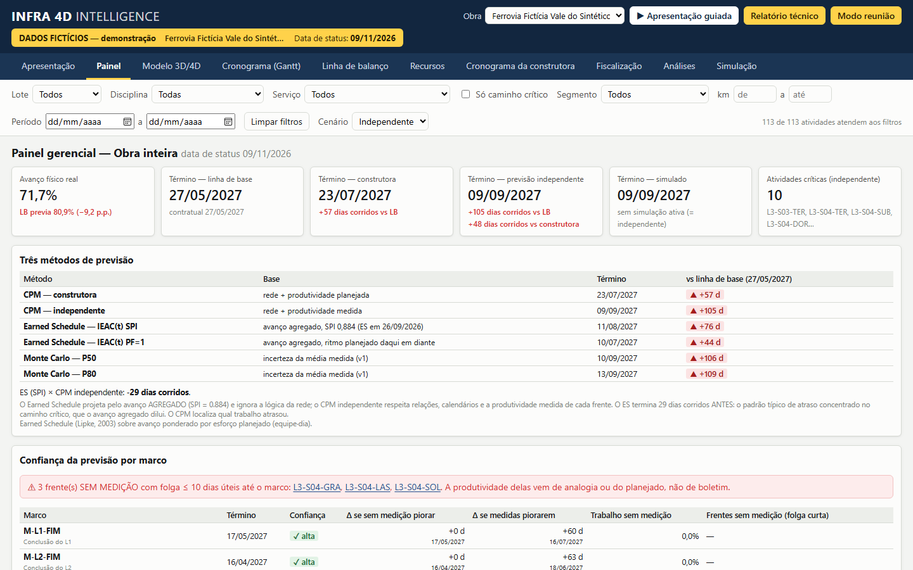
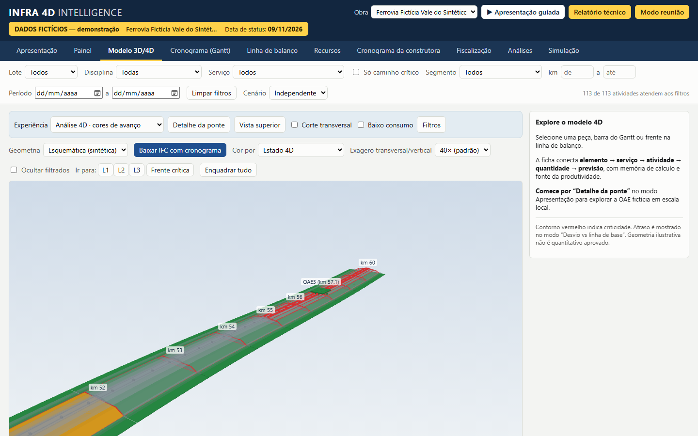
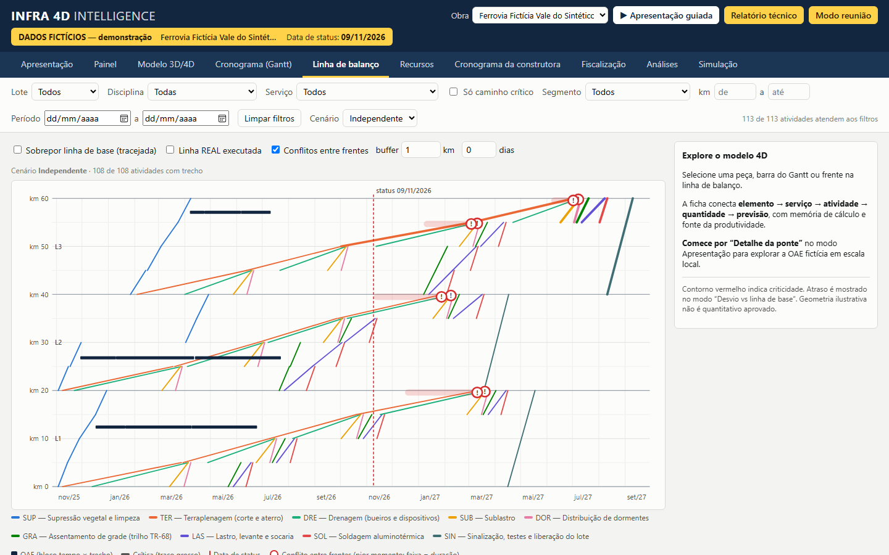
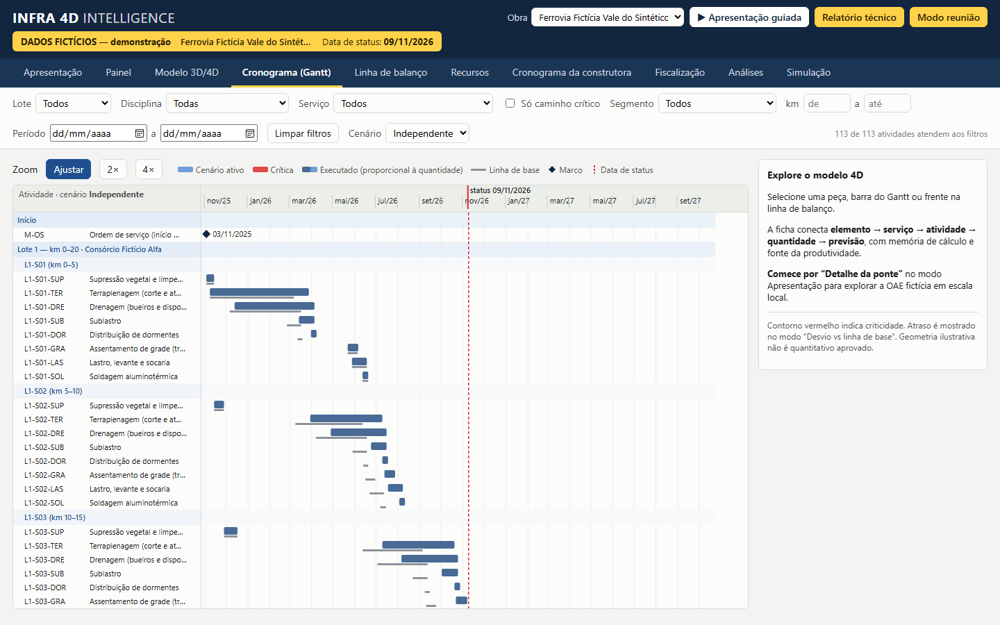
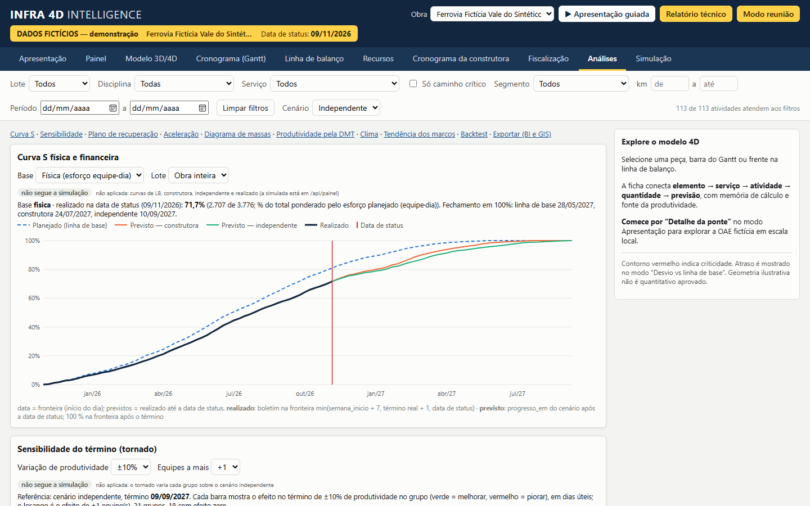
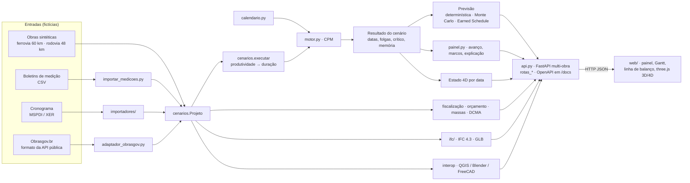

# INFRA 4D Intelligence

> **Summary in English.** INFRA 4D Intelligence is a local-first BIM 4D platform for linear infrastructure works
> (railways and highways). It recomputes the completion date **independently** from the contractor: measured
> productivity from field reports drives activity durations, a home-built CPM engine (FS/SS/FF/SF with lags,
> per-activity calendars, status date, total/free float) propagates the effect through the network, and the result is
> shown in a dashboard, a Gantt chart, a linear (time–chainage) chart and a three.js 3D/4D viewer, together with an
> auditable explanation of *why* the date moved. It adds Monte Carlo (P10–P90), Earned Schedule, DCMA checks,
> MSPDI/XER import-export, IFC 4.3 via IfcOpenShell, and GeoJSON interop with QGIS/Blender/FreeCAD. Python + FastAPI
> backend, static ES-module frontend, ~2,200 automated tests. All data in this repository is synthetic.

Plataforma BIM 4D de monitoramento físico, análise de caminho crítico e **previsão independente de conclusão** para
obras rodoviárias e ferroviárias.

> **Dados fictícios.** Versão sanitizada de um sistema em uso real; identificadores do cliente foram substituídos.

---

## Problema

Em obra linear (rodovia, ferrovia), a previsão de término costuma vir de quem executa a obra. A fiscalização recebe
uma data, mas não tem como recalcular sozinha o efeito da produtividade real sobre a rede de atividades, nem explicar
**por que** o prazo mudou entre uma medição e outra. Cronogramas chegam em formatos fechados (Primavera P6, MS
Project), modelos BIM ficam isolados do planejamento e o vínculo entre "o que foi medido no km X" e "a data final"
se perde em planilhas.

## Solução

- **Produtividade medida → duração:** os boletins de medição (quantidade, equipes·dia, trecho executado) geram a
  produtividade efetiva por atividade/lote/serviço; a duração remanescente sai dela, com memória de cálculo.
- **Motor CPM próprio** (Python puro, sem dependência): relações FS/SS/FF/SF com lag, calendário por atividade,
  marcos, restrição SNET, data de status com *progress override*, folga total e livre, caminho crítico e cadeia
  determinante; recusa redes inválidas (ciclos nomeados, referências inexistentes).
- **Quatro cenários comparáveis:** linha de base, construtora (produtividade planejada), independente (produtividade
  medida) e simulado (ajustes do usuário, isolados das análises de referência — ADR-0013).
- **Previsão:** término determinístico, Monte Carlo P10/P50/P80/P90 reprodutível, Earned Schedule (IEAC(t)),
  backtest contra um gabarito sintético isolado da previsão (ADR-0012), análise de sensibilidade (tornado).
- **Fiscalização e controle:** curva S, linha de balanço, índice DCMA, não conformidades, riscos de prazo, recursos,
  massas/DMT de terraplenagem, orçamento com BDI e reajuste (ADR-0011), exportação CSV/ZIP para BI.
- **BIM 4D:** estado 4D por data (fração executada por atividade → cor no 3D), visualizador three.js com fallback 2D,
  IFC 4.3 (exportar/importar, quantidades, GLB) via IfcOpenShell.
- **Interoperabilidade:** importa/exporta MSPDI (MS Project XML) e XER (Primavera P6); GeoJSON com contrato
  `infra4d.interop/1` para QGIS, Blender e FreeCAD, com prévia e recusa explícita de revisões incompatíveis (ADR-0016).
- **Dado fictício marcado por construção:** toda base sintética declara `meta.ficticio: true`; geradores de dado
  inventado recusam bases sem a marca (ADR-0005).

## Telas (dados fictícios)

Capturas da interface local (`run-beta.ps1`, obra sintética "Ferrovia Fictícia Vale do Sintético", data de status
09/11/2026), geradas com Edge headless em 19/11/2026.

| Painel: três métodos de previsão | Modelo 3D/4D (three.js) |
|---|---|
|  |  |
| **Linha de balanço (tempo × km) com conflitos entre frentes** | **Cronograma (Gantt) com linha de base** |
|  |  |
| **Curva S física (linha de base × construtora × independente)** | |
|  | |

## Arquitetura

Beta **local-first** (ADR-0002): um processo Python (FastAPI + uvicorn em `127.0.0.1:8765`), interface estática
servida pelo próprio processo, SQLite opcional. Sem rede, sem serviço externo, sem build de frontend.



Detalhes em [docs/ARQUITETURA.md](docs/ARQUITETURA.md) e nos ADRs em [docs/decisions/](docs/decisions/).

## Números

| Indicador | Valor | Fonte |
|---|---|---|
| Suíte Python completa | **2236 passed, 6 skipped, 0 failed**, exit 0, 689 s — Python 3.12 com o `requirements.txt` completo (inclui IfcOpenShell), nesta versão pública em 19/11/2026; os 6 skips exigem navegador (cobertos pelo E2E) | execução local na cópia sanitizada |
| Mesma suíte sem IfcOpenShell | os testes que dependem do IFC dão **SKIP com motivo** (`tests/ifc_opcional.py`); o resto da API segue testado | `tests/ifc_opcional.py` |
| E2E da interface (navegador headless) | Chrome **227 PASS**, Edge **231 PASS**, 0 falhas | `docs/STATE.md` |
| Revisão adversarial do motor CPM | **42 defeitos** confirmados em 3 rodadas, todos corrigidos e transformados em teste de regressão | `docs/STATE.md` |
| Rodadas de revisão adversarial no total | r2 a r23 (arquivos `tests/test_revisao_adversarial_*.py`) | código |
| Base ferroviária sintética | 60 km, 3 lotes, 12 segmentos, 113 atividades, 264 relações, 463 boletins | `docs/STATE.md` |
| Base rodoviária sintética | BR-FIC 999, 48 km, 137 atividades | `docs/STATE.md` |
| Limite de recálculo do vertical slice | ≤ 2,0 s (produtividade → rede → término → painel → 4D), verificado por teste | ADR-0004, `tests/test_vertical_slice.py` |

Não há métrica de uso real nem de tempo economizado: o sistema só rodou com dados sintéticos.

## Limitações (honestas)

- **Só dados sintéticos.** Nenhuma obra real passou pelo sistema nesta versão; a previsão foi medida contra um
  "futuro" sintético (backtest), não contra obra concluída.
- **Compatibilidade com Primavera P6 / MS Project não é alegada.** A ida e volta XER/MSPDI dá as mesmas datas dentro
  do próprio sistema, mas os arquivos ainda não foram abertos num P6 ou Project reais. Divergências conhecidas do
  motor: *progress override* (o P6 usa *retained logic*), só restrição SNET, granularidade de dia inteiro.
- **IFC:** exporta IFC 4.3 válido pelo `ifcopenshell.validate`, mas ainda não leu modelo IFC de cliente; o teste
  manual no Bonsai/BlenderBIM está pendente. Geometria de pontes e terreno é **ilustrativa**, não projeto.
- **Interoperabilidade CAD/GIS** (QGIS, Blender, FreeCAD) verificada por scripts; a etapa com interface gráfica do
  FreeCAD ainda exige observação manual.
- **Beta local, uma máquina, sem login**, sem homologação por engenheiro responsável. Os coeficientes de engenharia
  da base sintética não têm fonte normativa completa (risco RK5 do `docs/STATE.md`).
- **Previsão:** um fator escondido (ex.: usina limitada) só aparece depois do primeiro boletim daquela frente;
  nenhum método determinístico o antecipa — limite documentado no backlog (R12).

## Como rodar

Pré-requisitos: Windows + PowerShell 5.1, Python 3.12 ou 3.13 e Git.

```powershell
.\bootstrap.ps1      # cria .venv, instala requirements.txt e verifica o ambiente
.\run-beta.ps1       # abre http://127.0.0.1:8765/  (API documentada em /docs)
```

Sem PowerShell:

```bash
python -m venv .venv && .venv/bin/pip install -r requirements.txt   # Windows: .venv\Scripts\pip
PYTHONPATH=scripts .venv/bin/python -m uvicorn infra4d.api:app --host 127.0.0.1 --port 8765
```

Todos os dados usados vêm de `examples/` e são **fictícios**:

- `examples/synthetic/ferrovia_ficticia.json` e `rodovia_ficticia.json` — obras geradas com semente fixa por
  `scripts/infra4d/dados_sinteticos*.py` (um teste garante que o JSON versionado é idêntico à saída do gerador);
- `examples/fixtures/` — boletins CSV válidos e com erros, cronogramas MSPDI/XER mínimos e uma resposta
  fictícia no formato da API pública do Obrasgov.br.

### Testes

```bash
python -m pytest tests -q                      # suíte completa (~12 min, ~2.240 testes)
python -m pytest tests/test_motor_cpm.py -q    # um arquivo isolado
```

No Windows, `.\tests\run-tests.ps1` faz o mesmo usando o `.venv`. O módulo IFC é opcional: sem IfcOpenShell, os
testes de IFC dão SKIP com o motivo explícito e a API segue funcionando. Os testes E2E da interface ficam em
`tests/e2e/` e exigem Chrome ou Edge. Roteiro de demonstração: [docs/DEMO-5-MINUTOS.md](docs/DEMO-5-MINUTOS.md).

## O que eu decidi × o que a IA gerou

O código foi escrito com **Claude Code** e **Codex** como ferramentas, sob especificação, revisão e aceite meus. As
decisões de produto, arquitetura e governança abaixo são minhas e estão registradas em ADRs:

| Decisão (autora) | Registro |
|---|---|
| Beta local-first, Python + web estática, sem dependência comercial nem build de frontend | ADR-0002 |
| Construir um motor CPM próprio, auditável linha a linha, em vez de reutilizar biblioteca | ADR-0003 |
| Só dados sintéticos na PoC, cálculo determinístico (sem LLM na previsão) e critério de pronto numérico (recálculo ≤ 2 s) | ADR-0004 |
| Marca booleana `meta.ficticio` obrigatória; geradores recusam base sem ela | ADR-0005 |
| BDI pela fórmula do TCU, declarado por obra, e reajuste com anualidade | ADR-0011 |
| Gabarito do mundo sintético isolado da previsão, com guarda estática e teste contrafactual | ADR-0012 |
| Simulação do usuário nunca contamina as análises de referência (selo na interface) | ADR-0013 |
| `tipo_obra` declarado, sem padrão silencioso (erro 422 com motivo) | ADR-0014 |
| Commit verificado em snapshot isolado; teste de mutação só em cópia | ADR-0015 |
| Revisões de CAD/GIS nativas publicadas em cópia, separadas da demonstração; módulos GPL fora do processo | ADR-0016 |
| Portão de autorização C0–C5 antes de qualquer dado real | `docs/prog/PORTAO-DE-AUTORIZACAO.md` |

**Gerado com IA sob minha revisão:** implementação dos módulos em `scripts/infra4d/` e `web/`, a maior parte dos
testes, as rodadas de revisão adversarial (agentes independentes atacando o código; cada defeito confirmado virou
teste de regressão) e os relatórios de pesquisa em `docs/research/`. Os prompts de missão e os registros de sessão
usados para orquestrar os agentes são material operacional interno e não acompanham esta versão pública.

## Roadmap (itens em aberto no backlog — sem data)

O desenvolvimento está pausado aguardando revisão da autora; nada abaixo é compromisso. Fonte: `docs/BACKLOG.md`.

- Previsão: analogia pelo **recurso compartilhado** (ex.: usina que atende dois lotes) e gerador sintético coerente
  com essa restrição (P2/P3); sinal antecedente fora dos boletins (P6).
- Recursos: o nivelamento atual é heurístico (SGS serial, não ótimo); avaliar otimização (OR-Tools) como camada
  separada.
- BIM: modelos grandes no navegador (web-ifc/@thatopen) e contexto GIS com 3D Tiles.
- Validação externa: abrir XER/MSPDI exportados em P6/Project reais; teste manual do IFC no Bonsai.
- Operação com dado real só depois do portão de autorização C0–C5 (`docs/prog/PORTAO-DE-AUTORIZACAO.md`).

## Stack

- **Backend:** Python 3.12/3.13, FastAPI, uvicorn, pydantic, SQLite (opcional)
- **Cálculo:** motor CPM, calendários, Monte Carlo e Earned Schedule próprios em Python puro
- **BIM/IFC:** IfcOpenShell 0.9 (IFC 4.3, GLB) — opcional, LGPL usado sem modificação
- **Frontend:** HTML + ES modules sem build, three.js r170 vendorizado (MIT)
- **Interop:** MSPDI (MS Project XML), XER (Primavera P6), GeoJSON, QGIS, Blender, FreeCAD (como programas externos)
- **Testes:** pytest, FastAPI TestClient, E2E em Chrome/Edge headless (`tests/e2e/`)

## Estrutura

```
infra-4d-intelligence/
├── scripts/infra4d/   motor CPM, cenários, previsão, fiscalização, IFC, importadores, interop, API (rotas_*)
├── web/               interface (painel, Gantt, linha de balanço, 3D/4D com three.js)
├── examples/          obras sintéticas e fixtures fictícias
├── tests/             suíte pytest + E2E da interface
└── docs/              STATE, arquitetura, ADRs, pesquisa, interop, demonstração
```

O README operacional original está em [docs/README-original-sanitizado.md](docs/README-original-sanitizado.md).

## Licença e atribuições

- Código próprio: **todos os direitos reservados**, publicado só para visualização em avaliação de portfólio — ver
  [LICENSE](LICENSE).
- Terceiros: three.js r170 (MIT) vendorizado em `web/vendor/three/`; dependências Python (FastAPI MIT, uvicorn e
  httpx BSD-3, pytest MIT, IfcOpenShell LGPL-3.0-or-later sem modificação) — lista completa em [NOTICE](NOTICE).
- O que foi trocado nesta versão pública: [SANITIZACAO.md](SANITIZACAO.md).

## Aviso

*Dados fictícios. Versão sanitizada de um sistema em uso real; identificadores do cliente foram substituídos.*
Projeto em estado beta, sem homologação profissional por engenheiro responsável.

Autora: Emmily Maciel — [github.com/Emmilymaciell](https://github.com/Emmilymaciell)
