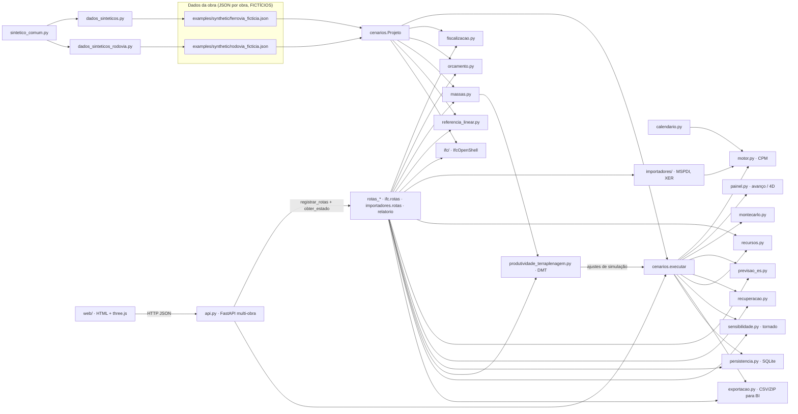
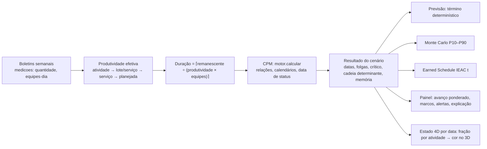

# ARQUITETURA — INFRA 4D INTELLIGENCE

> Incremento V3 de 13–14/11/2026: o retrato histórico abaixo é complementado
> por `interop.py`, `rotas_federacao.py`, adaptadores QGIS/Blender e módulos web
> de apresentação/federação. Contrato: `docs/interop/CONTRATOS-ADAPTADORES.md`;
> isolamento: ADR-0016; provas e limites atuais: topo de `docs/STATE.md`.
> O motor CPM e a referência da demonstração continuam os existentes.

> Retrato do que **existe e tem teste** em 2026-11-12; §3 (registro de rotas), §4.4 e §7 revistos em 2026-11-13. A base é o commit `e4b9be5`, mais os módulos do disco ainda
> não commitados na data desta revisão: sensibilidade, produtividade pela DMT, exportação para BI, recuperação, IFC
> por tipo de obra com GLB e tour guiado. Nada aqui é plano. O que ainda não roda está em `docs/IMPLANTACAO-REAL.md`
> e `docs/BACKLOG.md`.
> Fontes: o código em `scripts/infra4d/` e `web/`, os testes em `tests/`, o `CHANGELOG.md`, o `docs/STATE.md` e os
> ADR-0001 a 0005.
> **Todos os dados do sistema hoje são FICTÍCIOS** (ADR-0004), marcados com `meta.ficticio: true` (ADR-0005).

## 1. Visão em uma tela

Beta **local-first** (ADR-0002). Os componentes:
- um processo Python (FastAPI + uvicorn em `127.0.0.1:8765`, pelo `run-beta.ps1`);
- uma interface estática (HTML + ES modules + three.js vendorizado) servida pelo próprio processo;
- um banco SQLite opcional em `output/`, ignorado pelo Git.

Não usa rede, serviço externo nem build de frontend. O núcleo de cálculo é Python puro, sem dependência de
terceiros (ADR-0003). IfcOpenShell (LGPL-3.0-or-later, usado sem modificação) é opcional e só o módulo IFC o usa.

## 2. Fluxo de dados central (o vertical slice)

Essa cadeia é verificada ponta a ponta pela API HTTP em `tests/test_vertical_slice.py`: alterar a produtividade de
um serviço muda a duração, a rede, o término, o painel e o estado 4D. O tempo de recálculo é conferido contra
`verificacao.limites.tempo_maximo_recalculo_s` do `project.yaml`.

Toda data exibida pode ser rastreada. A atividade carrega a sua `memoria`: a quantidade, a fonte da produtividade
com o número de boletins e a fórmula aplicada.

## 3. Contratos entre módulos

| Contrato | Forma | Onde é testado |
|---|---|---|
| **Convenção de tempo** | Datas são ordinais inteiros. `t` é o **início** do dia, e a atividade ocupa `[ES, EF)` em dias úteis do seu calendário. A data exibida é `ultimo_dia_util(EF)`. Todos os módulos seguem isso (motor, recursos, fiscalização, orçamento, ES). | `test_motor_cpm.py`, revisões adversariais motor/r2/r3 |
| **Motor ↔ resto** | O motor recebe `AtividadeCPM` e `Relacao` e não sabe a origem delas. Os importadores e os cenários são adaptadores. | `test_motor_cpm.py`, `test_importadores_*.py` |
| **Projeto** | `cenarios.Projeto(dados)`: o dicionário da obra mais calendários e atividades indexados. Chaves de topo idênticas nas duas obras; a diferença está em `meta.tipo_obra`. | `test_dados_sinteticos.py`, `test_dados_rodovia.py` |
| **Cenário** | `cenarios.executar(projeto, cenario, ajustes)` → dicionário com `termino`, `atividades[id]` (es, ef, folgas, crítica, memória), `caminho_critico` e `data_status`. Cenários: `linha_base`, `construtora`, `independente`, `simulado`. | `test_smoke.py`, `test_vertical_slice.py` |
| **API multi-obra** | `obter_estado(obra)` → `Estado` com `.projeto` e `.resultado(cenario)`; obra desconhecida devolve 404. Obras são descobertas em `examples/synthetic/*_ficticia.json`. | `test_api_obras.py` |
| **Registro de rotas** | Cada módulo expõe `ligar(app, obter_estado)` ou `router`. `registrar_rotas` tolera módulo ausente ou quebrado: ele fica em `app.state.rotas_indisponiveis` e aparece em `/api/saude`, sem derrubar a API. A lista em `api.registrar_rotas` tem **26 nomes** na data desta revisão (2026-11-13): `importadores.rotas`, `ifc.rotas`, `rotas_recursos`, `rotas_referencia`, `rotas_previsao`, `rotas_fiscalizacao`, `rotas_massas`, `rotas_persistencia`, `rotas_orcamento`, `rotas_recuperacao`, `rotas_produtividade`, `rotas_exportacao`, `rotas_sensibilidade`, `rotas_dcma`, `rotas_clima`, `rotas_medicoes`, `rotas_riscos`, `rotas_gis`, `rotas_tendencia`, `rotas_curva_s`, `rotas_revisoes`, `rotas_backtest`, `rotas_aceleracao`, `rotas_cobertura`, `rotas_atribuicao` (`GET /api/backtest/atribuicao`) e `relatorio`. Todos os arquivos existem no disco (inclusive `rotas_dcma.py`). | `test_api_obras.py`, `test_openapi.py` (toda rota com descrição e 4xx próprio) |
| **Elemento BIM ↔ atividade** | Sintético: `elemento_id = <atividade_id>-E<nn>`. IFC: `Pset INFRA4D_Vinculo.AtividadeId`, depois `IfcRelAssignsToProduct`, depois `IfcRelAssignsToProcess` (`IfcTask.Identification`). | `test_ifc.py` |
| **Medição ↔ produtividade** | Os boletins (`medicoes`) são a **única** fonte da produtividade efetiva. | `test_vertical_slice.py`, `test_montecarlo.py` |
| **API ↔ 3D** | `/api/estado4d?data=&cenario=` devolve a fração executada por atividade. O navegador só pinta, sem recalcular. | `test_vertical_slice.py`, e2e |
| **Dado inventado** | Todo código que gera dado derivado (diários, custo real AC, riscos sintéticos) exige `meta.ficticio is True` (booleano). O texto do aviso não decide. | `test_revisao_adversarial_r6.py`, `test_fiscalizacao.py`, `test_orcamento.py` |
| **Dados imutáveis e caches** | O dicionário `projeto.dados` de um `Estado` **nunca é alterado no lugar**. Quase todos os caches de módulo usam a identidade desse dicionário como chave (IFC e persistência usam hash do conteúdo). Persistir uma mudança (ex.: medições importadas) = criar um `Projeto` NOVO, trocar `est.projeto` e limpar `est.cache`. A simulação só troca `cache["simulado"]`, depois de calculada. Rotas que de propósito usam o cenário não simulado declaram `simulacao_do_usuario`. | `test_caches_coerentes.py` |
| **Limites declarados** | Critério e tolerâncias vêm do `project.yaml`, pela fixture `limite("nome")`, e nunca ficam cravados na asserção. Limite ausente faz o teste falhar. | `tests/conftest.py` |

## 4. Módulos

Legenda da coluna "Sintético": o que o módulo **inventa ou assume** além do dado da obra.

### 4.1 Núcleo de cálculo

| Módulo | Faz | Verificado em | Limitações declaradas | Sintético |
|---|---|---|---|---|
| `calendario.py` | Dias úteis, feriados, chuva como dia não útil, aritmética em tempo de trabalho, horizonte 2020–2040 (fora dele é erro) | `test_motor_cpm.py`, revisões adversariais | Só dia inteiro, sem horas nem turnos | — |
| `motor.py` | CPM com FS/SS/FF/SF e lag ± (no calendário da predecessora); calendário por atividade; marcos; SNET e FNLT; data de status com *progress override* ou *retained logic*; folga total e livre; crítico; cadeia determinante; recusa ciclo e entrada incoerente | `test_motor_cpm.py`, `test_revisao_adversarial_motor.py`, `_r2`, `_r3`, `_r4` (47 defeitos corrigidos e convertidos em regressão) | Sem *must finish*, *ALAP*, lag em %, lag no calendário da sucessora nem nivelamento no CPM. **Compatibilidade com P6/Project não é alegada** (ADR-0003) | — |
| `cenarios.py` | Liga a obra ao motor: duração por quantidade, hierarquia de fontes da produtividade, os 4 cenários, ajustes de simulação, explicação contrafactual da mudança de término | `test_smoke.py`, `test_vertical_slice.py` | O cenário "construtora" é **premissa** (remanescente na produtividade planejada), não a atualização real de uma construtora | Cenário "construtora" |
| `painel.py` | Avanço físico ponderado por esforço planejado (equipe·dia), estado 4D, marcos contratuais, sensibilidade à lógica de progresso | `test_vertical_slice.py`, `test_painel_marcos.py` | O peso do avanço **não é financeiro** (o 5D é separado e fictício) | — |

### 4.2 Previsões e análise

| Módulo | Faz | Verificado em | Limitações declaradas | Sintético |
|---|---|---|---|---|
| `montecarlo.py` (`/api/previsao-probabilistica`) | v1: bootstrap dos boletins com correlação dentro da frente. v2 opcional: cópula gaussiana entre frentes (`rho`), riscos discretos e chuva estocástica. Com os padrões, reproduz a v1 bit a bit | `test_montecarlo.py`, `test_revisao_adversarial_r8.py` | A v1 dá faixa estreita (está documentado). Sem boletim, usa a planejada × U(0,80; 1,05) | Riscos sintéticos quando a obra não tem lista própria (exige `meta.ficticio`) |
| `previsao_es.py` (`/api/previsao/earned-schedule`) | Earned Schedule de Lipke: SPI(t), IEAC(t), IECD por obra e por lote, com avanço físico ponderado | `test_previsao_es.py`, `test_relatorio.py`, `test_revisao_adversarial_r8.py` | Unidade de tempo em dia corrido; sem custo. **Casos de borda abertos na r8** (xfail: patamar, lote ainda não iniciado, data de status antes do início, lote vazio) | — |
| `recuperacao.py` (`/api/recuperacao`) | O que precisa render para cumprir um prazo: bisseção por frente ou escalonamento guloso de menor esforço sobre o conjunto determinante | `test_recuperacao.py` | **Heurístico**, não é otimização global (declarado) | — |
| `sensibilidade.py` (`/api/sensibilidade?p=&equipes=`) | Gráfico tornado do término. Para cada (lote, serviço) pendente, a produtividade efetiva ×(1−p) e ×(1+p) e uma variante com +equipes; Δ do término em dias úteis e corridos. Classifica em efeito zero, assimétrico e **reverso** (paradoxo de rede). A rota tem cache por (dados, p, equipes) | `test_sensibilidade.py` (rede pequena à mão + as duas obras) | Custo: 1 + (2 ou 3) × nº de grupos execuções do motor; um parâmetro por vez, sem interação entre grupos | — |
| `recursos.py` (`/api/recursos`) | Histograma de equipes e equipamentos, sobrealocação, nivelamento SGS serial (só acrescenta SNET), conflitos de linha de balanço com cruzamento analítico e pela linha executada | `test_recursos.py`, `test_revisao_adversarial_r5.py` | O nivelamento é **heurístico** (SGS), com prova independente de que as relações seguem satisfeitas; capacidades vêm dos dados | Capacidades e frotas da base sintética |
| `relatorio.py` (`/api/relatorio`) | Relatório HTML imprimível, gerado dos mesmos resultados (CPM, ES e Monte Carlo), com HTML escapado e CSP sem script | `test_relatorio.py`, `test_api_seguranca.py` | — | Reflete os dados da obra |

### 4.3 Dados, interoperabilidade e domínio

| Módulo | Faz | Verificado em | Limitações declaradas | Sintético |
|---|---|---|---|---|
| `dados_sinteticos.py`, `dados_sinteticos_rodovia.py`, `sintetico_comum.py` | Geradores determinísticos (semente fixa). Rede planejada, fator de desempenho por (lote, serviço), corte na data de status e boletins com ruído | `test_dados_sinteticos.py`, `test_dados_rodovia.py` (JSON versionado idêntico ao gerador) | Premissas de engenharia **[OG]** em R03 e R06 (ordem de grandeza sem fonte) | **Tudo** |
| `importadores/` (`/api/cronograma`) | MSPDI: exporta e importa, só com biblioteca padrão. XER: importa e, desde `xer_exportar.py`, também exporta (`GET /api/cronograma/exportar/xer`, ida e volta pelo importador próprio). Comparação entre o cronograma da construtora e o motor. DOCTYPE recusado; tetos de volume; upload de até 20 MB | `test_importadores_mspdi.py`, `test_importadores_xer.py`, `test_revisao_adversarial_r5.py` | Validado só por ida e volta própria e fixtures escritas à mão (`examples/fixtures/`). **Nenhum arquivo real de Project ou P6 testado.** Listas `LIMITACOES_MSPDI` e `LIMITACOES_XER` | Fixtures |
| `ifc/` (`/api/ifc`, opcional) | Exporta IFC4X3_ADD2 **por tipo de obra**: `IfcRailway/IfcRailwayPart` ou `IfcRoad/IfcRoadPart`, classes por serviço, IfcAlignment pelo método PI, Pset de vínculo, IfcWorkSchedule/IfcTask/IfcRelSequence. Importa a tabela de vínculo (Pset → `IfcRelAssignsToProduct` → `IfcRelAssignsToProcess`, com conflito apontado); gera malha JSON e **GLB nativo** (`node.name` = GlobalId, Y para cima) que casa 1:1 com `/api/ifc/vinculo`; GlobalIds determinísticos; upload de até 100 MB | `test_ifc.py` (as duas obras; o módulo inteiro dá SKIP sem `ifcopenshell`), R07 (`ifcopenshell.validate` com 0 erros). Testes com **arquivos externos** da buildingSMART (Infra-Rail/Road, modelos de alinhamento), baixados para `output/ifc/externos` e conferidos por SHA-256; dão SKIP sem rede, com `INFRA4D_SEM_REDE=1` ou se o hash mudou | Ainda sem IFC de cliente. Tipo de obra sem mapeamento é recusado com motivo. **A interface 3D carrega o GLB** pelo seletor "Geometria → Modelo IFC (GLB)" (`web/app.js` `trocarGeometria`; `web/viewer3d.js` `carregarIfc`). O GLTFLoader casa `node.name` com o GlobalId de `/api/ifc/vinculo`, pinta cada malha pelo estado 4D com a mesma regra das peças sintéticas e mostra o modelo em escala real, sem exagero vertical. Se `ifc.rotas` estiver indisponível ou o GLB falhar, a tela volta à geometria esquemática e mostra o erro. Verificado no e2e (`tests/e2e/verificar_interface.py`, bloco "modo IFC", nas duas obras) | Geometria e alinhamento sintéticos |
| `referencia_linear.py` (`/api/referencia`) | km ↔ estaca (20 m como **convenção**), equações de estaca com trecho, ambiguidade e salto; km → xy/cota/rumo; xy → km com afastamento e lado; cobertura | `test_referencia_linear.py`, `test_revisao_adversarial_r6.py` | Km tratado como medida do eixo (não é comprimento geométrico); sem fator de escala UTM | Eixo sintético |
| `fiscalizacao.py` (`/api/fiscalizacao`) | Diário e boletim estendido no modelo da IN 57/DNIT/2021; validação campo a campo; estados `lancado → conferido_fiscal → aprovado`; conciliação diário × boletim; produtividade trabalhada × calendário; linha real tempo-km | `test_fiscalizacao.py`, `test_revisao_adversarial_r6.py` | Não substitui o SIAC nem alega conformidade. Fotos só como referência (com hash). Avisos de coerência não bloqueiam | **Diários** derivados dos boletins (exige `meta.ficticio`) |
| `massas.py` (`/api/massas`) | Seção trapezoidal, volumes pela média das áreas, Fh, empolamento, ondas de Brückner, DMT e coerência com a quantidade de TER | `test_massas.py` | Terreno transversal plano, sem seção mista. A ferrovia fica ~23% abaixo da premissa de TER: o módulo aponta a diferença e não corrige o dataset | Perfil de terreno sintético |
| `produtividade_terraplenagem.py` (`/api/produtividade/terraplenagem`) | Produtividade de TER em função da **DMT**: ciclo da frota (escavadeira + n caminhões), produção = min(escavadeira, caminhões), empolamento, DMT do segmento ponderada pelas ondas de Brückner de `massas.py`. Devolve `ajustes_recomendados` no formato do `POST /api/simulacao` e o efeito no término | `test_produtividade_terraplenagem.py` (ciclo calculado à mão + as duas obras) | Parâmetros de frota são premissas **[OG]** (`ParametrosFrota`, R06). Os ajustes são recomendação: só valem se o usuário simular | Frota e DMT derivadas do terreno sintético |
| `orcamento.py` (`/api/orcamento`) | 5D **fictício**: composições com custo decomposto, BAC, curva S financeira (PV/EV/AC), EVM de custo e mapa IFC → composição (derivado do exportador IFC, não uma 2ª tabela). **BDI declarado por obra** em `BDI_DECLARADO` pela fórmula do TCU (ferrovia 23,48%, rodovia 22,22%, dentro da faixa 19,60–24,23% do Acórdão 2622/2013 [B], R11); `bdi=` explícito substitui. **Reajuste** `R = V × (Ii − I0)/I0` (IN 01/DNIT/2023) com índice SINTÉTICO por disciplina e anualidade; valores com e sem reajuste lado a lado. O EV na data de status é ancorado em executado × preço; os boletins só o distribuem no tempo, com a mesma regra de semana terminada de `curva_s.py` | `test_orcamento.py`, `test_revisao_adversarial_r9.py` | **Nenhum dado do SICRO ou SINAPI** (CC BY-ND e termos não verificados, R05 §5). São erro: unidade divergente, quantidade negativa e linha de base ausente, invertida ou sem dia útil | **Preços, BDI e AC** (o AC exige `meta.ficticio`) |
| `exportacao.py` (`/api/exportar`) | Tabelas para BI em modelo estrela (dimensões obra, lote, segmento, serviço, atividade; fatos cronograma por cenário, boletins, curva S, marcos, conflitos e histograma). CSV pt-BR (`;` e `,` configuráveis) com BOM, datas ISO, booleanos 1/0, **proteção contra CSV injection** (OWASP) e ZIP com LEIAME e aviso. Não grava em disco | `test_exportacao.py` | Destino Power BI, Excel ou Superset por arquivo, sem conector | Exporta o que a obra tem (hoje fictício, com aviso no pacote) |
| `persistencia.py` (`/api/historico`) | SQLite da biblioteca padrão em `output/infra4d.sqlite` (ou `INFRA4D_BANCO`): cenários salvos com conferência de reprodução (hash dos dados), snapshots, **auditoria**, evolução mensal | `test_persistencia.py`, `test_revisao_adversarial_r8.py` | O campo "quem" é **texto informado**: o beta não tem autenticação | Evolução mensal sintética (recalculada em memória) |

### 4.4 Módulos acrescentados depois de `e4b9be5` (uma linha cada; fatos lidos no código)

| Módulo | Faz | Rota | Teste |
|---|---|---|---|
| `riscos_prazo.py` | Registro consolidado de riscos ao prazo: junta sinais já calculados (produtividade crítica, restrições, clima, tornado, criticidade do MC, ES × CPM, recuperação, balanço, DCMA), cada um com a rota e o caminho JSON que o reproduz; fonte ausente vira `fontes_omitidas` | `GET /api/riscos` | `test_riscos_prazo.py`, `test_revisao_adversarial_r15.py` |
| `gis.py` | GeoJSON (RFC 7946) para QGIS: eixo, lotes, segmentos, atividades no estado 4D, marcos, restrições, conflitos, estacas e faixa; **georreferência FICTÍCIA** (âncora lat/lon por tipo de obra + plano tangente local; serve para visualizar, não para locação) | `GET /api/gis/geojson` | `test_gis.py` |
| `tendencia.py` | MTA (Milestone Trend Analysis): fotografias da obra em datas de status passadas, sem dado futuro (boletim só de semana terminada), e o término dos marcos por cenário | `GET /api/tendencia` | `test_tendencia.py` |
| `curva_s.py` | Curva S física e financeira por obra e lote: planejado, previsto construtora, previsto independente e realizado, com a regra de semana terminada da MTA | `GET /api/curva-s` | `test_curva_s.py`; igualdade com o EV do orçamento em `test_orcamento.py` |
| `backtest.py` | Backtest das previsões (construtora, independente, ES) sobre as fotografias da MTA contra duas referências declaradas: `final_independente` (parcialmente circular, medida) e `realidade_simulada` | `GET /api/backtest`, `GET /api/backtest/sementes` | `test_backtest.py` |
| `aceleracao.py` | Aceleração com custo FICTÍCIO (crashing guloso): equipes extras nas frentes determinantes pelo menor custo por dia ganho, com mobilização; não é ótimo global | `GET /api/aceleracao` | `test_aceleracao.py` |
| `comparar_revisoes.py` | Comparação forense de duas versões de cronograma (dataset, MSPDI ou XER): atividades, relações, calendários e datas que mudaram | `GET`/`POST /api/revisoes/comparar` | `test_comparar_revisoes.py`, `test_revisao_adversarial_r16.py` |
| `cobertura.py` | Declara em que evidência se apoia o término previsto de cada marco (medida na atividade, no lote, analogia da obra, planejada, ajuste do usuário) sem mudar a previsão | `GET /api/cobertura` | `test_cobertura.py` |
| `clima.py` | Cenários climáticos: término independente com outro regime de chuva no remanescente; só calendário com a marca booleana `sensivel_chuva` | `GET /api/clima` | `test_clima.py` |
| `dcma.py` | DCMA 14 pontos sobre um cenário do motor ou sobre o cronograma importado (MSPDI/XER); limites conferidos no Deltek Acumen 8.11 | `GET /api/dcma`, `POST /api/dcma/importado` | `test_dcma.py` |
| `importar_medicoes.py` | Importa boletins/diários por CSV UTF-8 (biblioteca padrão), valida e recalcula EM MEMÓRIA; nunca grava no dataset | `POST /api/medicoes/importar` | `test_importar_medicoes.py`, `test_revisao_adversarial_r14.py` |
| `nao_conformidade.py` | Não conformidade da fiscalização como entidade (id, atividade/elemento, km, abertura, gravidade, prazo, situação aberta/em_tratamento/encerrada, encerramento, evidência só por referência + sha256). Validação estrita; vencida = não encerrada com prazo antes da data de status; alerta = não encerrada em atividade crítica do independente; `fonte_riscos` no formato das fontes de `riscos_prazo`. NCs vêm da lista opcional `nao_conformidades` do dataset (os publicados não têm); `?exemplos=true` gera 3 NCs SINTÉTICAS só em obra fictícia (409 senão) | `GET /api/fiscalizacao/nao-conformidades` (por `rotas_fiscalizacao`, sem módulo novo no registro) | `test_nao_conformidade.py` |
| `aviso_simulacao.py` | Campo `simulacao_do_usuario` nas rotas que usam de propósito o cenário independente (clima, aceleração, recuperação, riscos, ES); o orçamento declara o seu | — (usado pelas rotas) | `test_simulacao_do_usuario.py`, `test_caches_coerentes.py` |
| `importadores/xer_exportar.py` | Exporta XER (PROJECT, CALENDAR, TASK, TASKPRED) no subconjunto que o importador lê; P6 real **não** alegado | `GET /api/cronograma/exportar/xer` | `test_importadores_xer.py`, `test_comparar_revisoes.py` |
| `ifc/cronograma.py` | Cronograma NATIVO IFC 4.3 por cenário (IfcWorkPlan/IfcWorkSchedule/IfcTask/IfcTaskTime WORKTIME, IfcRelSequence + IfcLagTime, IfcWorkCalendar WEEKLY + exceções) e a ida e volta pelo motor. Leitura por outros programas: ver R13 (defeito de calendário no IfcOpenShell 0.9.0) | `GET /api/ifc/exportar` (com 4D), `POST /api/ifc/cronograma` | `test_ifc_cronograma.py` |
| `ifc/requisitos.py`, `ifc/quantidades.py` | Requisitos de informação BIM 4D/5D sem `ifctester` (GlobalId único, vínculo, classificação, quantidades, km…) e quantidades por peça (Qto oficial + `INFRA4D_Quantidade` geométrica e contratual) | `GET`/`POST /api/ifc/requisitos` | `test_ifc.py` |
| `adaptador_obrasgov.py` | Protótipo: JSON no formato da API pública do Obrasgov.br → esquema parcial do projeto (obra, lotes por contrato, marcos, % físico); não acessa a rede | — | `test_adaptador_obrasgov.py` (fixture FICTÍCIA) |
| `numeros_demo.py` | Lê da API em memória os números do roteiro da demo, nas duas obras | — (`python -m infra4d.numeros_demo`) | `test_numeros_demo.py` |

### 4.5 API e interface

| Módulo | Faz | Verificado em | Limitações declaradas |
|---|---|---|---|
| `api.py` | FastAPI multi-obra: `/api/saude`, `/api/obras`, `/api/projeto`, `/api/cenarios/{c}`, `/api/comparacao`, `/api/simulacao` (GET/POST/DELETE), `/api/estado4d`, `/api/painel`, `/api/previsao-probabilistica` e `registrar_rotas`. A simulação fica **em memória por processo**. Cabeçalhos (`csp_interface`): CSP com `default-src 'self'`, `script-src 'self'` mais o hash SHA-256 de cada importmap inline do `index.html` (recalculado a cada requisição), `object-src 'none'` e `frame-ancestors 'none'`; `style-src` ainda aceita `'unsafe-inline'`. No relatório, CSP sem script. `nosniff` e `no-referrer` em todas as respostas | `test_api_obras.py`, `test_api_seguranca.py`, `test_vertical_slice.py` | Sem autenticação, sem HTTPS, ouve só em `127.0.0.1`. Estado de simulação compartilhado entre quem acessa o mesmo processo |
| `web/` | Abas Apresentação, Painel, Modelo 3D/4D, Gantt, Simulação, Linha de balanço, Recursos, Cronograma da construtora, Fiscalização; seletor de obra; faixa permanente de dado fictício. **Tour guiado** (`tour.js`, botão "Apresentação guiada", `#...&tour=1`): cerca de 12 passos que **executam** a ação (trocar aba, selecionar, mover a timeline, simular, comparar cronograma). Os números do texto são lidos da API na hora; cada um fica num `<b data-num>` para o e2e conferir | `tests/e2e/verificar_interface.py` (Chrome headless, fora do pytest; 77 checagens segundo o CHANGELOG), `test_revisao_adversarial_r7.py` | Só Chrome headless/SwiftShader (sem Edge, Firefox ou GPU real). **Defeitos abertos da r7** (xfail): campos sem escape em templates `innerHTML`, `dataBR` sem validação, estaca calculada no navegador, fração 0 em atividade de duração fixa, tratamento de erro da API incompleto, sem tratador global de erro |

## 5. Decisões registradas

| ADR | Decisão | Efeito na arquitetura |
|---|---|---|
| 0001 | Nascimento protegido: Git em `main`, remoto privado, **dado bruto no Drive e nunca no Git** | Sem arquivo operacional no repositório (`.gitignore`) |
| 0002 | Local-first: Python + web estática, sem dependência comercial; IFC na fase 2 com IfcOpenShell sem modificação | Sem build, sem banco obrigatório, sem nuvem |
| 0003 | Motor CPM próprio; bibliotecas externas só como adaptadores; compatibilidade com P6/Project **só depois de ida e volta com arquivo real** | Importadores traduzem e o motor calcula |
| 0004 | Discovery: só dados sintéticos, cálculo determinístico (`componente_llm: false`), critério de pronto no manifesto | `dados_sensiveis: false`. **Deve ser substituído antes de entrar dado real** |
| 0005 | Marca booleana `meta.ficticio` como trava contra dado inventado sobre obra real | Geradores derivados ficam bloqueados por construção quando entrar dado real |

## 6. Como a verificação está montada

- **Suíte pytest** (`.\tests\run-tests.ps1`). O STATE registra **563 passando** no snapshot do commit `e4b9be5`,
  verificado em isolamento (git archive + suíte).
- **Revisão adversarial independente em 10 rodadas** (r10 confere invariantes ENTRE módulos pela API, em
  variações fictícias das duas obras). Cada defeito nasce como `xfail(strict=True)` e vira regressão quando é
  corrigido. Decoradores `xfail` contados no disco na data desta revisão:
  - r7 (frontend): 6;
  - r9: 8, sendo 6 do diagrama de massas (abertos) e 2 do orçamento, já corrigidos (dão XPASS, aguardando a
    remoção da marca);
  - r8: nenhum aberto;
  - r10: 1 variação marcada por `pytest.param` (não é decorador). Na `rodovia-plano`, obra sem boletins, o
    determinístico fica fora da faixa do Monte Carlo: o cenário usa a planejada × 1,00 e o MC sorteia
    planejada × U(0,80; 1,05).

  A contagem muda a cada rodada. Para conferir, procure `@pytest.mark.xfail(strict` em
  `tests/test_revisao_adversarial_*.py`; o `grep -c "xfail(strict"` também conta as menções nas docstrings.
- **E2E da interface** no Chrome headless, fora do pytest. Exit 2 significa "não rodou" e não conta como verde.
- **Incidente aberto:** suítes completas rodando em paralelo travaram com 0% de CPU. Mitigação: `pytest.ini` com
  `faulthandler_timeout = 300` e uma suíte completa por vez. A causa raiz não foi achada até a data deste
  documento.

## 7. O que é sintético, em uma lista

1. As duas obras inteiras (rede, quantidades, boletins, eixo, terreno), geradas com semente fixa.
2. O cenário "construtora" (premissa de recuperação), não a atualização real de uma construtora.
3. Os diários de obra (derivados dos boletins), o custo real AC e a lista de riscos do Monte Carlo v2. Os três
   exigem `meta.ficticio`.
4. As composições, os preços e o BDI do 5D.
5. A geometria 3D e o IFC exportado (derivados do eixo e das atividades sintéticas), inclusive o cronograma
   nativo IFC.
6. A evolução mensal da previsão (recalculada "como se" em datas de status passadas).
7. As premissas de engenharia marcadas [OG] em R03 e R06, inclusive os parâmetros de frota (`ParametrosFrota`)
   usados na produtividade pela DMT.
8. A **georreferência** do GeoJSON (`gis.py`): âncora lat/lon fictícia por tipo de obra e faixa de domínio fictícia.
9. O **índice de reajuste** do 5D (`orcamento.TAXA_MENSAL_FICTICIA`) e os componentes do BDI declarado: não são
   séries do DNIT/FGV nem BDI de contrato.
10. A **realidade simulada** (`dados_sinteticos*.realidade_simulada`): o "futuro" que o gerador sorteou e não
    exporta, usado só como referência do backtest. O motor nunca a vê.
11. O custo das equipes extras na aceleração (preços fictícios do orçamento e mobilização fictícia).
